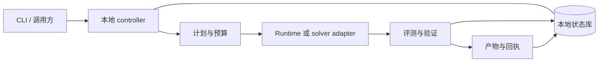

# Lunar Evolution

[](https://github.com/vchive/Lunar-Evolution/actions/workflows/test.yml)
[](https://www.python.org/)
[](LICENSE)

**Lunar Evolution 是一个本地优先的 Agent 任务与算法演化控制器。** 它负责规划和调度任务、记录评测与产物，并保存检查或恢复运行所需的证据。运行时仅依赖 Python 标准库；mock 工作流可以离线使用，不需要模型密钥。

项目提供两类工作流：

- **Agent 任务执行**：创建计划，使用 mock、子进程或显式配置的 OpenAI-compatible runtime 执行任务，再检查并交付已验证产物。
- **算法求解与 RSI**：求解算法问题，或运行有预算约束的学习流程。provider-free RSI fixture 可回归持久化与恢复控制，不会启动真实 solver。

当前重点是可靠的单机执行和基于证据的恢复。原生 producer 接入仍属实验能力，并有独立准入门禁。RSI 生产准入和在线发布保持关闭；fixture 或本地 smoke 通过不代表生产验收或模型质量达标。

[快速开始](#快速开始) · [运行普通任务](#运行普通任务) · [试跑-rsi-fixture](#试跑-rsi-fixture) · [架构说明](docs/architecture.md) · [发布工作台账](docs/current-release-backlog.md)

## 当前能力

| 能力 | 已具备 | 边界 |
| --- | --- | --- |
| 本地 Agent 任务 | 持久化计划、任务执行、评测、产物、状态查询、取消与恢复 | mock 用于确定性验证控制链；真实模型或 runtime 需显式配置。 |
| 算法求解 | 对话式 `solve`、本地 population evolution、显式配置的本地 OpenEvolve 命令 | 候选得分依赖所配置的 evaluator，不保证一般意义上的求解质量。 |
| RSI 学习控制 | provider-free DRS/BRS fixture、持久化 ledger、用量查询、replay 和显式 reconcile | `rsi run` 默认执行 fixture，不会运行真实 producer。 |
| 恢复控制 | 预算、deadline、组件身份与 checkpoint 校验；未知结果要求对账 | 证据检查不代表外部进程或 runtime 已满足生产要求。 |
| Producer 接入 | 固定 OpenEvolve/Shinka 源码准备、编译配方、只读 preflight 与 retained evidence 诊断 | 真实隔离构建、sealed runtime、项目生命周期及 Linux 中断验收仍未完成。 |
| 显式外部 worker | HMAC 来源认证、持久 assignment、固定 SSH 通道、一次性派发与只读对账 | 固定 inert producer 已验证跨机通道；真实候选的账户隔离与断线后清理仍待验收。 |

当前产品形态是本地 CLI 与 Python 库，单个 controller 持有本机 ledger 的权威写入权。
可显式配置固定外部 worker；未知执行结果保留为 unknown，不能凭超时自动重派。
多 controller 接管、分布式调度、服务 API 和远程 evaluator 不属于当前交付范围。

## 快速开始

需要 Python 3.11 或更高版本。克隆仓库并安装命令行工具：

```bash
git clone https://github.com/vchive/Lunar-Evolution.git
cd Lunar-Evolution
python3 -m venv .venv
source .venv/bin/activate
python -m pip install -e .
lunar-evolution --help
```

开发回归使用 `uv.lock` 中的依赖，保持测试参数 ID 和历史用例清单可重复：

```bash
python -m pip install 'uv==0.11.8'
uv sync --locked --no-python-downloads --extra dev --extra lint
```

## 运行普通任务

mock runtime 可离线、确定性地试跑控制链；它不会真正解决自然语言目标。状态默认写入 `LUNAR_EVOLUTION_HOME` 指定的目录；未设置该变量或 `--home` 时使用当前目录下的 `.lunar-evolution/`。

```bash
lunar-evolution init --home .lunar-evolution --json
lunar-evolution run '生成一份本地执行报告' \
  --runtime mock --home .lunar-evolution --json
```

命令结果包含 `run_id`，之后可以查看运行状态和事件：

```bash
lunar-evolution status RUN_ID --home .lunar-evolution --json
lunar-evolution events RUN_ID --home .lunar-evolution --json
lunar-evolution resume RUN_ID --runtime mock --home .lunar-evolution --json
```

每个 run 的 workspace 位于 `<home>/runs/<run_id>/`；成功的 JSON 会包含
`status`、`run_id` 和 `workspace`。可用 `status` 与 `events` 检查记录，使用
`deliver RUN_ID --home .lunar-evolution` 获取已验证的产物。

### 离线试跑求解控制流

`solve` 的 mock 模式不需要模型服务，可用于确认本地计划和控制链路：

```bash
lunar-evolution solve '展示本地算法求解控制链路' \
  --runtime mock --home .lunar-evolution --json
```

该示例的成功 JSON 会带有 `run_id`、`workspace` 和 `run_status: "succeeded"`。
mock compiler 不会调用模型，也不会优化目标或生成算法输出；这只是运行链路
smoke check，不是求解质量证据。

### 使用 OpenAI-compatible 模型

在环境变量中设置完整的 chat-completions endpoint 和模型名。API key 从 `LUNAR_EVOLUTION_API_KEY` 读取；不要把密钥写入源码或命令历史。CLI 不会自动加载 `.env` 文件。

```bash
export LUNAR_EVOLUTION_MODEL_ENDPOINT='http://127.0.0.1:11434/v1/chat/completions'
export LUNAR_EVOLUTION_MODEL='your-model-name'

lunar-evolution solve '分析订单并提出可验证的配送路线' \
  --runtime openai-compatible --home .lunar-evolution --json
```

需要认证的服务还要在 shell 或密钥管理器中设置 `LUNAR_EVOLUTION_API_KEY`。如需让模型调用 Lunar 提供的本地工具，显式添加 `--agent-loop`；工具调用受步数、超时、workspace 和产物大小限制。配置变量名称可参考 [`.env.example`](.env.example)，但该文件仅为示例，CLI 不会自动加载它。

## 试跑 RSI fixture

下面的例子使用本地 fixture 验证 RSI controller 和持久化流程，不会调用模型、evaluator 或 OpenEvolve/Shinka producer。

```bash
mkdir -p .lunar-evolution/demo
printf '{"problem_id":"readme-fixture"}\n' \
  > .lunar-evolution/demo/contract.json

lunar-evolution rsi run .lunar-evolution/demo/contract.json \
  --run-id readme-rsi --mode drs --solver mock \
  --max-practice-rounds 1 --max-target-attempts 2 \
  --usage-ledger .lunar-evolution/demo/usage.json \
  --home .lunar-evolution --json

lunar-evolution rsi inspect readme-rsi --home .lunar-evolution --json
lunar-evolution rsi usage .lunar-evolution/demo/usage.json --json
```

恢复时沿用原 run ID 和 home：

```bash
lunar-evolution rsi resume readme-rsi \
  --usage-ledger .lunar-evolution/demo/usage.json \
  --home .lunar-evolution --json
```

恢复前会校验已保存的计划、预算、deadline、组件身份和记忆。episode 结果未知时，控制器保留证据并要求显式 reconcile，不会悄悄重试。这个示例验证的是控制行为，不是学习效果或生产准入。

## 架构与数据

CLI 调用 controller；controller 负责计划、预算、持久状态、恢复和交付检查。runtime 或 solver adapter 产生候选结果，evaluator 与 verifier 判断结果是否满足合同。运行记录和产物保存在本机 home 目录中。



默认的 `.lunar-evolution/` 包含普通任务状态库、RSI ledger 和各 run 的 workspace。应使用 CLI 检查运行结果，不要手工修改已持久化的证据来修复状态。

更多实现细节和验收边界见[架构与执行链路](docs/architecture.md)、[RSI 本地运行时](docs/rsi-local-runtime.md)和[发布工作台账](docs/current-release-backlog.md)。

## 验证代码变更

安装开发依赖后，可先运行 focused tests 或完整测试集：

```bash
PYTHONPATH=src .venv/bin/python -m pytest -q tests/test_rsi_*.py
PYTHONPATH=src .venv/bin/python -m pytest -q
.venv/bin/ruff check src tests tools
.venv/bin/python -m compileall -q src tests tools
git diff --check
```

CI 在 Ubuntu 上覆盖 Python 3.11、3.12 和 3.13。[Linux 开发指南](docs/linux-development.md)介绍测试分片和日志保留方式。除非测试明确说明，测试不会请求模型、远程 evaluator 或真实 solver campaign。

## 当前发布边界

provider-free DRS/BRS 控制与恢复路径已实现，并有本地回归覆盖。发布仍需通过固定预算的 mixed 回归和最终来源完整 CI；局部测试通过不能关闭这个门槛。真实 native producer 验收还需独立核验 Python 源码和 toolchain、隔离构建与 runtime 闭包、sealed startup、权威输入与结果处理、进程 ownership 与生命周期，以及 Linux 中断测试。OpenEvolve/Shinka 源码准备和 detached evidence reader 不会授予生产准入。

因此，RSI producer 的 `production_admission=false` 与 `online_publication=false` 仍是当前状态。外部 worker 的认证回执不授予 native 成功、结果发布或远端清理权威。远程 evaluator、多 controller 接管和模型权重训练不属于当前发布范围。哪些证据可以改变这些状态，见[发布工作台账](docs/current-release-backlog.md)。

## 贡献与许可

行为变更请同步更新相应规格和 focused tests，并运行上面的检查。不要提交 provider 凭据，也不要把 fixture 结果描述为独立生产验收证据。本项目使用 MIT License，完整条款见 [`LICENSE`](LICENSE)。
