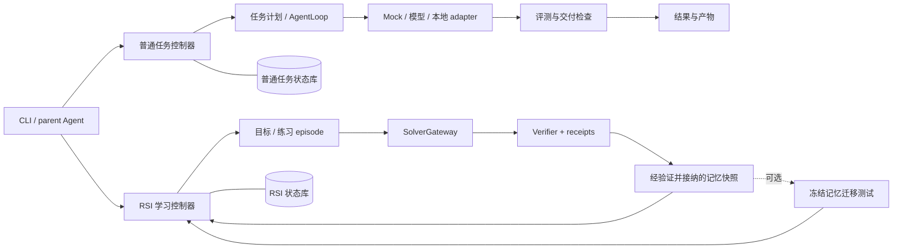

# Lunar Evolution

[](https://github.com/vchive/Lunar-Evolution/actions/workflows/test.yml)
[](https://www.python.org/)
[](pyproject.toml)

Lunar Evolution 是一个**本地优先、可恢复、可审计**的 Agent 与算法演化控制器。它管理从任务计划、候选生成、评测到产物交付的完整链路，并把预算、执行记录和恢复证据保留在本地。

你可以用 CLI 执行普通任务和算法求解，也可以用 Python API 组合 solver、verifier 与 RSI 学习流程。模型和本地 solver 按显式配置接入；默认回归使用 mock/fixture，可以在没有模型服务和密钥的环境中运行。

当前主线是单机可靠执行和 RSI（递归学习）控制闭环。RSI 改进候选程序与经验证的任务记忆；模型权重训练和修改 Lunar 自身代码不在当前主线内。RSI producer 路径保持 `production_admission=false`，真实 solver campaign 仍需独立验收。

[本地试跑](#五分钟本地试跑) · [RSI 示例](#rsi-provider-free-回归) · [执行链路](#执行链路) · [架构说明](docs/architecture.md) · [剩余工作与验收条件](docs/current-release-backlog.md)

## 当前状态

| 能力 | 状态 | 说明 |
| --- | --- | --- |
| 普通任务与 `solve` | ✅ 可用 | 本地 plan、AgentLoop、评测、artifact 和 delivery ledger。 |
| provider-free RSI（DRS/BRS） | ✅ 可回归 | 本地 mock/fixture；支持 run、inspect、resume、usage、replay、reconcile，不启动真实 producer。 |
| durable resume / unknown gate / fingerprint / budget | ✅ 已接入 | 恢复前复核原 checkpoint、预算、deadline 和组件身份；未知状态保留证据并拒绝自动重试。 |
| 单 child producer 执行 | 🧪 已合入的实验 API | PR99 已在 main；显式 `producer_child_execution=True` 的本地 fixture 闭环已验收，默认保持 staging-only。 |
| 同 workspace 连续 DRS 发布 | 🧪 统一候选待最终验收 | 三个不同 child、练习记忆晋级、目标重试与历史只读恢复已有本地验收；最终集成提交仍需完整 CI、独立审计与合入。 |
| DRS known rejection | 🧪 统一候选待最终验收 | 原 owner、连续 reconcile、早期中断及三组混合链已有本地验收和原证据审查；修复/parser 集成后的完整验收仍开放。 |
| BRS partial-wave resume | 🧪 本地已验证 | 已修复 completed admission obligation 被 pending-only scope 误判的问题；待最终集成 CI、审计与合入。 |
| 多 child native BRS | 🧪 私有组件已验证 | 已具备 selected owner service、独立 publication mailbox 和成功证据检查点；完整在线 owner 发布、恢复与连续 child 接线仍开放。公共 native BRS 与生产 admission 仍关闭。 |
| native producer / OpenEvolve / ShinkaEvolve 真实 campaign | ⏳ 未验收 | 需要真实 source、toolchain、runtime、process lifecycle 和独立 acceptance evidence。 |
| 远程 evaluator、多机 worker、分布式 scheduler | ⏸ 后置 | 不属于当前单机 RSI 正确性的前置条件。 |

恢复、parser、selected service、worker 发布拒绝与私有成功检查点已集中到同一个待验收后继，包含 PR103/105/106/107/108。最终候选直接面向 `main`，通过完整 33-job CI 与独立原始证据审查后合入；旧 PR 保留各自历史记录。当前 main 仍是 PR99 基线。CI badge 表示 main 的 workflow 状态；候选提交的实际来源、证据与结束条件见 [当前发布台账](docs/current-release-backlog.md)。

## 主要能力

- **普通任务执行**：把 goal 编译成有依赖关系的 plan，调度本地 task，记录 attempt、evaluation、artifact 和事件。
- **会话式算法求解**：`solve` 先生成严格的 `AlgorithmProblemContract`，再运行 `data_discovery → formulate → solve → verify`；可以选择本地 population evolution，或显式配置本地 OpenEvolve 命令。
- **受控产物交付**：候选源文件在隔离 workspace 中执行，交付前检查路径、格式、大小和 SHA-256；多文件发布、execution、delivery 和恢复证据都保留在 ledger 中。
- **RSI learning mode**：DRS 围绕目标缺口生成练习、验证记忆再重试目标；BRS 在冻结 wave 上横向展开。两者共享 run 预算、组件指纹、记忆治理和迁移证据。
- **证据优先恢复**：已完成的 side effect 只读重放；`unknown`、证据缺失、身份漂移、取消和 deadline 不会自动 retry 或晋级。

## 安装

要求 Python 3.11 或更高版本。运行时没有第三方依赖；下面安装 pytest、ruff，并使用与 CI 一致的 uv 版本建立开发环境。

```bash
git clone https://github.com/vchive/Lunar-Evolution.git
cd Lunar-Evolution
python3 -m venv .venv
. .venv/bin/activate
python -m pip install 'uv==0.11.8'
uv pip install --python .venv/bin/python -e '.[dev,lint]'
```

## 五分钟本地试跑

本地状态目录优先使用 `--home`，其次使用 `LUNAR_EVOLUTION_HOME` 环境变量，未配置时使用当前目录的 `.lunar-evolution/`。mock runtime 不读取网络、模型、凭据或机器上的其他 Agent 状态。

```bash
lunar-evolution init --home .lunar-evolution --json
mkdir -p .lunar-evolution/demo
lunar-evolution run '生成一个本地执行报告' \
  --runtime mock --home .lunar-evolution --json \
  > .lunar-evolution/demo/run.json

RUN_ID="$(python -c 'import json; print(json.load(open(".lunar-evolution/demo/run.json"))["run_id"])')"
lunar-evolution status "$RUN_ID" --home .lunar-evolution --json
lunar-evolution events "$RUN_ID" --home .lunar-evolution --json
```

成功时 `run.json` 包含 `run_id`、`status=succeeded` 和 `workspace`。mock 产生确定性的演示结果；真实业务任务需要配置模型或求解器。任务文件和产物保留在返回的 workspace 中。需要恢复时使用原来的 run ID：

```bash
lunar-evolution resume "$RUN_ID" \
  --runtime mock --home .lunar-evolution --json
```

### `solve` 与本地模型

没有模型服务时，先用 mock 编译和执行控制链：

```bash
lunar-evolution solve '根据订单数据设计配送路线' \
  --runtime mock --home .lunar-evolution --json
```

连接 OpenAI-compatible endpoint 时，以下示例显式提供 endpoint 和 model。建议通过环境变量提供密钥，避免写进仓库或命令历史：

```bash
export LUNAR_EVOLUTION_MODEL_ENDPOINT='http://127.0.0.1:11434/v1/chat/completions'
export LUNAR_EVOLUTION_MODEL='your-local-model'

lunar-evolution solve '分析订单并给出可验证的路线方案' \
  --runtime openai-compatible \
  --endpoint "$LUNAR_EVOLUTION_MODEL_ENDPOINT" \
  --model "$LUNAR_EVOLUTION_MODEL" \
  --home .lunar-evolution --json
```

endpoint 需要认证时，先在运行环境中配置 `LUNAR_EVOLUTION_API_KEY`；不需要认证的本地服务可以省略。普通 CLI 不自动加载 `.env`；配置字段可参考 [`.env.example`](.env.example)。需要工具调用时显式加 `--agent-loop`；`--max-steps`、workspace、超时和 artifact 限制仍由 Lunar 控制。

## RSI provider-free 回归

下面的命令只运行本地 fixture。`--solver` 记录 solver provenance，但不会启动 OpenEvolve、Shinka、远程 evaluator 或真实模型。

```bash
mkdir -p .lunar-evolution/demo
cat > .lunar-evolution/demo/rsi-contract.json <<'JSON'
{"problem_id":"readme-fixture"}
JSON

lunar-evolution rsi run .lunar-evolution/demo/rsi-contract.json \
  --run-id readme-rsi \
  --mode drs \
  --solver mock \
  --max-practice-rounds 1 \
  --max-target-attempts 2 \
  --usage-ledger .lunar-evolution/demo/rsi-usage.json \
  --home .lunar-evolution \
  --json
```

这里的最小 JSON 仅作为 fixture 演示输入；普通 `evolve` 使用完整算法合同。正常结果包含 `status=completed`、目标／练习统计、`solver_execution=provider_free_fixture` 和 `production_admission=false`。
在同一个 home 内开始另一轮演示时，使用新的 `--run-id`；恢复已有演示沿用原 ID。

```bash
lunar-evolution rsi inspect readme-rsi --home .lunar-evolution --json
lunar-evolution rsi usage .lunar-evolution/demo/rsi-usage.json --json
lunar-evolution rsi resume readme-rsi \
  --usage-ledger .lunar-evolution/demo/rsi-usage.json \
  --home .lunar-evolution --json
```

`resume` 复核原 run 的计划、预算、deadline、组件身份和历史记忆。结果为 `unknown` 时需要显式对账，控制器不会自动重启。已有 producer 结果的 `replay` 需要原始文件和独立摘要；高级恢复／重放接口见下面的运行时说明。

更完整的 Python API、数据模型、DRS/BRS wave、memory promotion、Actor clean-room evidence 和 producer receipt 说明见 [`docs/rsi-local-runtime.md`](docs/rsi-local-runtime.md) 与 [`specs/160-rsi-learning-mode/`](specs/160-rsi-learning-mode/)。

## 执行链路



CLI 选择入口，controller 管理执行、预算、持久状态和恢复；runtime／solver 负责产生候选和执行结果。评测、verifier 判断、记忆晋级和产物交付分别保留证据，未知结果进入恢复门禁。

普通任务和 RSI 都是单机流程；模型接口和本地 solver 按显式配置接入。完整架构与尚未验收的 native producer 边界见 [`docs/architecture.md`](docs/architecture.md) 和 [`docs/rsi-local-runtime.md`](docs/rsi-local-runtime.md)。

## 本地数据布局

```text
.lunar-evolution/
├── state.db                 # 普通任务 ledger
├── rsi.sqlite3              # RSI run / episode / receipt ledger
└── runs/<run-id>/            # prompt、result、evaluation、候选和发布证据
```

文件会记录 SHA-256、大小、相对路径，以及需要时的 inode/launch identity。不要手动编辑已完成 run 的证据文件来“修复”状态。

## 验证与开发

```bash
# RSI focused regression
PYTHONPATH=src .venv/bin/python -m pytest -q tests/test_rsi_*.py

# 当前测试
PYTHONPATH=src .venv/bin/python -m pytest -q

# 静态检查
.venv/bin/ruff check src tests tools
.venv/bin/python -m compileall -q src tests tools
git diff --check
```

GitHub Actions 在 Ubuntu 上运行 Python 3.11/3.12/3.13 的 focused、current shards 和 history jobs。需要复现 current shard 时：

```bash
.venv/bin/python tools/run_tests.py \
  --suite current --shard-index 0 --shard-count 6 --isolate-heavy \
  --junit-dir .lunar-evolution/test-results
```

完整 current 覆盖需要普通分片 0–5，以及三个独立重用例。重用例使用各自新结果目录，
分别运行 `--suite current-heavy --heavy-index 0`、`1`、`2`；它们与普通分片的精确
清单互斥且并集等于完整 collection。省略 `--isolate-heavy` 的旧 current 命令仍按
完整文件划分全部用例，但会把同文件的三个重用例放在同一分片，可能超过 CI job 时限。

测试保持 provider-free，不会因为运行测试而发起模型调用、远程 evaluator 或真实 solver campaign。

Linux / SSH 服务器的独立环境、六个普通分片加三个重用例的并行运行和日志保留步骤见 [Linux 开发指南](docs/linux-development.md)。

## 路线图与明确边界

### P0：收尾当前 DRS 发布批次

单 child 的 controller → gateway → scheduler → admission/publication → verifier → recovery 链路已合入 main。当前批次的剩余出口是：

- 统一后继包含 PR103/105/106/107/108 的全部提交，保留六个普通分片、三个独立重用例、focused 与 history；对最终来源完整验收后一次合入 `main`。
- known rejection 三组混合链已有独立本地证据；历史失败、取消和局部成功保留原标签，不代替最终候选完整 CI。

恢复始终复核原 claim、预算、身份、deadline 与取消门禁；没有原始证据的中断保留 unknown，不启动后继 child。

### P1：多 child BRS 与真实本地运行时

- 按 [Feature196 SDD](specs/196-brs-owner-worker-handoff/spec.md) 接通原 owner 的 retained recovery、native transaction、拒绝分支和独立结果交付，再完成 reconciliation、连续 child 和记忆策略。私有检查点已开发，不等于公开 native BRS 可用。
- 独立核验 Python source/toolchain/runtime，完成 sealed startup、loader negative tests、owner/lifecycle 和 Linux acceptance matrix。
- 基于已有 adapter/exporter 接通实际 OpenEvolve/Shinka project lifecycle、cancel/cleanup、producer admission 和生产用 opt-in CLI。
- 保留 provider-free 默认值；producer score 仍须经独立 verifier/evaluation 才能产生官方结论。

### P2：后置能力

远程 evaluator、外部 worker 来源认证、多机 ownership、分布式 scheduler、service API、远程 Shinka/Slurm，以及模型训练/SFT/RL 均后置。它们需要独立的身份、租约、故障与部署契约，不是本轮单机 DRS 发布的出口条件。

当前工作台账、结束条件和证据分级见 [`docs/current-release-backlog.md`](docs/current-release-backlog.md)；系统架构见 [`docs/architecture.md`](docs/architecture.md)。

## 贡献与许可证

`pyproject.toml` 声明项目使用 MIT license。提交代码时请同时更新对应 SDD spec、focused tests 和验证记录；不要提交 provider 凭据、远程运行结果或未经独立核验的 producer evidence。
