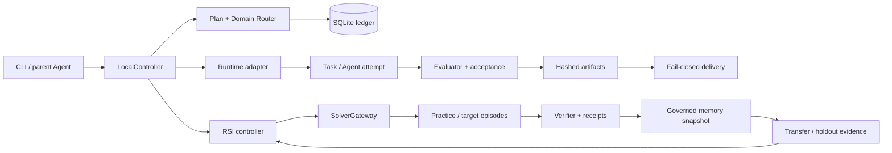

# Lunar Evolution

[](https://github.com/vchive/Lunar-Evolution/actions/workflows/test.yml)

**Lunar Evolution** 是一个本地优先（local-first）、可恢复、可审计的 Agent 与算法演化控制器。它把一次任务的计划、执行、证据、产物和恢复状态保存在本地 SQLite ledger 与 run workspace 中；模型、求解器和 evaluator 都是显式适配器，不会偷偷从机器上的全局 Agent 状态取配置。

项目采用 Spec-Driven Development（SDD）。当前主线聚焦于单机、provider-free 的可靠执行和 RSI（recursive/self-improving learning）控制闭环：先保证中断后能安全恢复、结果有独立证据、预算和身份不会漂移，再接入真实运行时。仓库目前保持 `production_admission=false`。

> 当前仓库验证的是本地 fixture 和协议行为。它**不宣称**已经完成真实模型效果、官方远程 evaluator、密封 CPython runtime、真实 OpenEvolve/Shinka campaign，或外部 worker 的可信身份认证。

## 能做什么

- **普通任务执行**：把 goal 编译为有依赖关系的 plan，调度本地 task，记录 attempt、evaluation、artifact 和事件。
- **会话式算法任务**：`solve` 先生成严格的 `AlgorithmProblemContract`，再运行 `data_discovery → formulate → solve → verify`；可以选择本地 population evolution，或显式配置的 OpenEvolve 命令。
- **受控产物交付**：候选程序在隔离的本地 workspace 运行，声明的文件经过格式、大小、路径和 SHA-256 检查后才能发布；多文件发布、terminal result、launch、execution 和 delivery 都保留可恢复证据。
- **RSI learning mode**：DRS（逐目标恢复）和 BRS（冻结 wave 批量恢复）共享 run 预算、组件 fingerprint、memory governance 和 transfer evidence。controller-level resume、unknown reconcile gate、fingerprint drift gate、统一预算和逐 episode durable staging 已接入本地链路。
- **只读诊断与回放**：可以 inspect ledger、读取 usage、replay 已保留 producer receipt；未知状态不会因为“看起来像成功”而自动重试或晋级。

## 快速开始

要求 Python 3.11 或更高版本。仓库没有运行时依赖，开发依赖只包含 pytest 和 ruff。

```bash
git clone https://github.com/vchive/Lunar-Evolution.git
cd Lunar-Evolution
python3 -m venv .venv
. .venv/bin/activate
python -m pip install -e '.[dev,lint]'
```

初始化本地状态目录并运行 deterministic mock runtime：

```bash
lunar-evolution init --home .lunar-evolution --json
lunar-evolution run '生成一个本地执行报告' \
  --runtime mock --home .lunar-evolution --json
# 将上一步返回的 run_id 代入：
lunar-evolution status <run-id> --home .lunar-evolution --json
lunar-evolution events <run-id> --home .lunar-evolution --json
lunar-evolution resume <run-id> --runtime mock --home .lunar-evolution --json
```

mock runtime 不访问网络、模型、凭据或全局 Hermes/OpenCode/Codex 状态。所有状态都在 `--home` 指定的目录中；默认目录是当前工作目录下的 `.lunar-evolution/`，也可以使用 `LUNAR_EVOLUTION_HOME`。

## 会话式 `solve`

`solve` 适合从自然语言目标开始。先用 mock 编译和执行，可以在没有模型服务的环境中验证控制链：

```bash
lunar-evolution solve '根据订单数据设计配送路线' \
  --runtime mock --home .lunar-evolution --json
```

需要澄清的信息会返回 `status=awaiting_input`。对同一个 `run_id` 使用 `answer`，不会创建第二个任务：

```bash
lunar-evolution answer <run-id> '目标是最小化总行驶时间' \
  --runtime mock --home .lunar-evolution --json
```

连接 OpenAI-compatible endpoint 时必须显式提供 endpoint 和 model；密钥建议通过环境变量传入：

```bash
export LUNAR_EVOLUTION_MODEL_ENDPOINT='http://127.0.0.1:11434/v1/chat/completions'
export LUNAR_EVOLUTION_MODEL='your-local-model'
export LUNAR_EVOLUTION_API_KEY='set-in-your-shell-only'
lunar-evolution solve '分析订单并给出可验证的路线方案' \
  --runtime openai-compatible \
  --endpoint "$LUNAR_EVOLUTION_MODEL_ENDPOINT" \
  --model "$LUNAR_EVOLUTION_MODEL" \
  --home .lunar-evolution --json
```

`--agent-loop` 会启用有界的工具循环；`--max-steps`、workspace、超时和 artifact 限制仍由 Lunar 控制。README 不要求也不保存任何密钥。

## RSI provider-free fixture

RSI CLI 当前用于可重复的本地协议回归。`--solver` 只记录 fixture provenance；它不会启动 OpenEvolve、Shinka、远程 evaluator 或真实模型。

```bash
cat > /tmp/rsi-contract.json <<'JSON'
{"problem_id":"readme-fixture"}
JSON

lunar-evolution rsi run /tmp/rsi-contract.json \
  --run-id readme-rsi \
  --mode drs \
  --solver mock \
  --max-practice-rounds 1 \
  --max-target-attempts 2 \
  --home .lunar-evolution \
  --json
```

典型结果包含 `status=completed`、`memory_snapshot_sha256`、`target_attempts`、`practice_episodes`、`recovery_eligibility=terminal`、`solver_execution=provider_free_fixture` 和 `production_admission=false`。如果 worker 状态为 `unknown`，运行会 fail-closed：

```bash
lunar-evolution rsi inspect readme-rsi --home .lunar-evolution --json
lunar-evolution rsi resume readme-rsi --home .lunar-evolution --json
```

`resume` 只读取原始 run 的 plan、request、memory、deadline、预算和 fingerprint；它不会重新 staging、重复扣费、采用磁盘上新出现的 proof，或自动重启一个结果未知的 episode。需要人工观察后，使用 `rsi reconcile` 提交与原记录绑定的显式状态：

```bash
lunar-evolution rsi reconcile <episode-id> \
  --worker-state failed \
  --expected-record-sha256 <record-sha256> \
  --home .lunar-evolution --json
```

`rsi inspect`、`rsi usage`、`rsi replay` 和 `rsi reconcile` 都是本地 ledger 操作。更完整的 Python API、DRS/BRS wave、memory promotion、Actor clean-room evidence、usage 统计和 producer receipt 说明见 [`docs/rsi-local-runtime.md`](docs/rsi-local-runtime.md) 与 [`specs/160-rsi-learning-mode/`](specs/160-rsi-learning-mode/)。

## 执行链路



执行时的关键边界：

1. CLI 只创建一个可追踪的 run handle；SQLite ledger 是状态和 CAS（compare-and-swap）迁移的权威来源。
2. controller 先检查 plan、预算、deadline 和组件 fingerprint，再允许新的 side effect。
3. runtime adapter 不拥有 durable state；每个 attempt 的 prompt、结果、evaluation 和 artifact 都写入 run workspace 并索引到 ledger。
4. evaluator 与 acceptance contract 分开保存；评分、receipt、verifier decision 和 memory admission 不能互相冒充。
5. `deliver` 只交付验证通过且已持久化的 artifact；中断、证据缺失、身份漂移或数据库提交状态未知时保持 `unknown`/`manual review`。

普通任务和 RSI 都是单机控制面。当前没有把 Lunar 拆成必须部署的微服务；外部 producer 只可通过显式、受 pin 约束的本地 handoff 接口接入。

## 可审计数据布局

每个 home 目录大致包含：

```text
.lunar-evolution/
├── state.db                 # 普通任务 ledger
├── rsi.sqlite3              # RSI run / episode / receipt ledger
└── runs/<run-id>/            # prompt、result、evaluation、候选和发布证据
```

实际布局会随命令和 feature 变化。文件会记录 SHA-256、大小、相对路径和必要的 inode/launch identity；不要手动编辑已完成 run 的证据文件来“修复”状态。

## 验证与开发

针对当前代码的快速检查：

```bash
# RSI focused regression
PYTHONPATH=src .venv/bin/python -m pytest -q tests/test_rsi_*.py

# 普通当前测试（不包含历史快照）
PYTHONPATH=src .venv/bin/python -m pytest -q

# 静态检查
.venv/bin/ruff check src tests tools
.venv/bin/python -m compileall -q src tests tools
git diff --check
```

GitHub Actions 在 Ubuntu 上以 Python 3.11/3.12/3.13 运行 focused、current shards 和 history jobs。需要复现一个 current shard 时：

```bash
.venv/bin/python tools/run_tests.py \
  --suite current --shard-index 0 --shard-count 3 \
  --junit-dir .lunar-evolution/test-results
```

完整 release runner 还会在固定的历史 checkout 上运行 archived/frozen registration；它们是不可变回归证据，不应与当前工作树的测试混为一谈。所有验证都保持 provider-free：不会因为运行测试而发起模型调用、远程 evaluator 或真实 solver campaign。

## 当前边界与路线图

### P0：先把本地闭环做完整

- 完成逐 episode child proof 从 controller → gateway → scheduler → store/admission/native claim 的完整运行时接线。
- 在本地 fixture 中覆盖 practice success、target retry、多个 child、取消、deadline、进程中断和只读恢复。
- 对每个 side effect 保留 launch、execution、receipt、publication 和 unknown reconcile 证据。

### P1：接入真实本地运行时

- 取得并独立核验真实 Python source/toolchain/runtime，完成静态构建、sealed startup、loader negative tests 和 owner/lifecycle 验收。
- 为 OpenEvolve/Shinka 增加受 pin 约束的本地 process adapter、result export、cancel/cleanup、producer admission 和 production RSI CLI；保留原始 receipt，不把 score 直接当 official verdict。
- 在不改变 provider-free 默认值的前提下，完成真实本地 runtime 的 Linux acceptance matrix。

### P2：明确后置

- remote evaluator protocol、external worker authentication、multi-host ownership、distributed scheduler、service API、remote Shinka/Slurm，以及模型训练/SFT/RL。
- 这些工作会引入新的身份、租约、故障和部署边界；它们不是当前单机 RSI 正确性的前置条件。

详细的当前工作台账、结束条件和证据分级见 [`docs/current-release-backlog.md`](docs/current-release-backlog.md)。设计、数据模型和验证文档集中在 [`specs/160-rsi-learning-mode/`](specs/160-rsi-learning-mode/)。系统架构细节见 [`docs/architecture.md`](docs/architecture.md)。

## 许可证与贡献

`pyproject.toml` 声明项目使用 MIT license。提交代码时请同时更新对应的 SDD spec、focused tests 和验证记录；不要把 provider 凭据、远程运行结果或未经独立核验的 producer evidence 提交到仓库。
